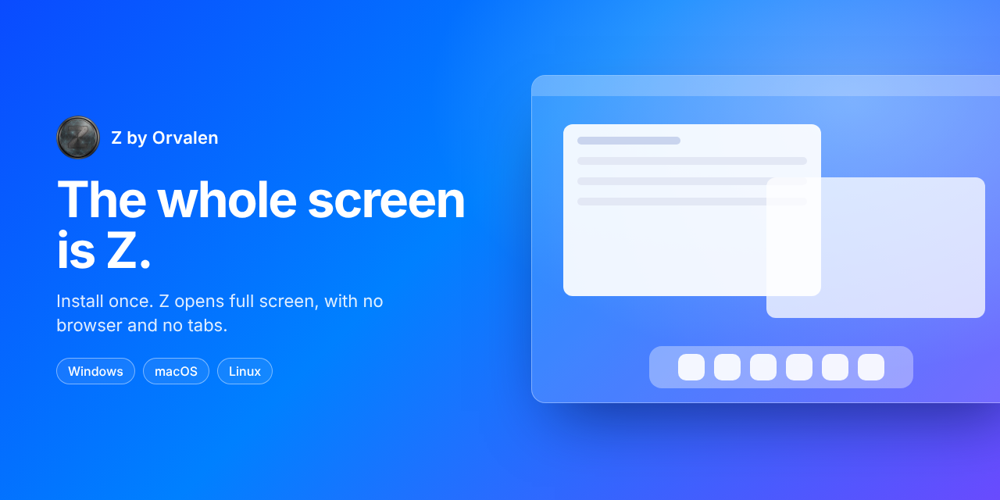

<p align="center"></p>

# Z for desktop

Z is an operating system that runs on the web. This app opens Z on your computer in true full screen, the way a game does: no browser, no tabs, no address bar. The whole screen is your Z desktop.

**Windows 10/11 · macOS 12 and later (Intel and Apple Silicon) · Linux (AppImage, DEB)**

## Download

Installers will appear on the [Releases](../../releases) page and at [orvalen-official.com](https://orvalen-official.com) once the first version is out.

| System | File |
| --- | --- |
| Windows | `Z-Web-Setup-<version>.exe`: about 1 MB, downloads the right version for your PC while it installs |
| Windows (offline) | `Z-Setup-<version>.exe`: the full installer, for computers without a steady connection (Intel/AMD) |
| macOS | `Z-<version>-mac-universal.dmg` |
| Linux | `Z-<version>-linux-x86_64.AppImage` or `z-desktop_<version>_amd64.deb` |

## First launch

The app is not digitally signed yet, so the first launch shows a warning. Signing is coming. Until then, here is how to open it. You only do this once.

**Windows**
1. Open `Z-Web-Setup.exe`.
2. In the blue "Windows protected your PC" box, click **More info**.
3. Click **Run anyway**. Z installs and opens full screen.

If Windows says the app was blocked and offers no **Run anyway**, Smart App Control is on. It only allows signed apps, so this version can't be installed on that PC yet. Please don't turn Smart App Control off for this: the signed version will install normally.

**macOS**
1. Open the `.dmg` and drag **Z** into **Applications**.
2. Open Z. macOS says it can't verify the developer. Click **Done**.
3. Go to **System Settings → Privacy & Security**, click **Open Anyway**, then **Open**.

**Linux**
- AppImage: right-click the file → **Properties** → **Allow executing as program**, then open it.
- DEB (Ubuntu, Debian): double-click the file and choose **Install**, or run `sudo apt install ./z-desktop_<version>_amd64.deb`.

## Using it

- **F11** switches between full screen and a window (on macOS also **Ctrl+Cmd+F**).
- **Alt+Tab** / **Cmd+Tab** move between apps as usual.
- Links to other websites open in your normal browser.
- Each installer has a SHA256 checksum next to it, so you can check the download.
- **Updates:** on Windows and with the AppImage, new versions download in the background, and Z asks whether to restart now to install them. Nothing installs until you click "Restart now"; with "Later", Z asks again the next time it starts. On macOS and with the DEB, Z tells you when a new version is out and opens the download. Updates come only from this repository's Releases page. Right-click the Z icon (or the Z menu on macOS) → **Check for updates** to check right away.
- Sign in with email and password. Google sign-in arrives in the next version.

## What the app does, and what it doesn't

This app is a small, focused window around [orvalen.me](https://orvalen.me). It contains no Z code; Z itself loads from the web and updates there.

- Only Z loads inside the window. Everything else opens in your browser.
- The page inside the window has no access to your files or your system.
- Camera, microphone and location: the first time Z asks, the app asks you. Your answer is remembered, and you can undo it any time: right-click the Z icon → **Reset permissions** (on macOS also in the Z menu). Other sites never get these.
- No tracking and no data collection by the app. It stores a few settings on your computer: the language you chose in Z, your camera, microphone and location answers, and an update notice you chose to skip. To look for updates it asks GitHub for the latest release; nothing about you is sent.

## Making a release

Only Orvalen can make a release: `main` and the `v*` tags are protected, and the release run waits for Orvalen's approval. Raise `version` in `package.json`, merge to `main`, then run **Actions → Release → Run workflow** and approve it. It builds every installer and puts them in a draft release. Check the draft, then click **Publish release**: from that moment the download links and the apps' update check see the new version.

## Build from source

Requires Node.js 22.

```bash
npm install
npm start            # run it
npm run check        # quick checks
npm run dist:linux   # or dist:win, dist:mac (each on its own system)
```

---

Made by [Orvalen](https://orvalen-official.com).
